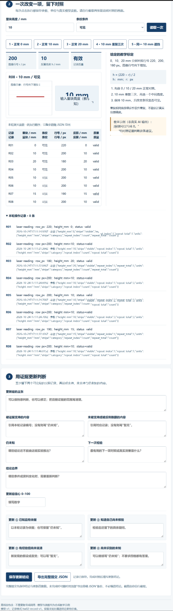
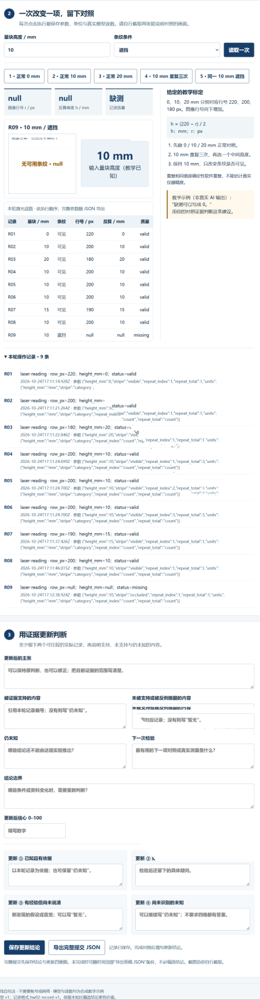

# HW02 · 用证据修正一个判断

GitHub 账号：junqing4ll；案例：A · 量块标定与缺测（laser）。

本报告依据本人离线操作后原样导出的 [record.json](evidence/record.json)、两张原始对照截图和本人提供的核算过程整理。实验台使用教学合成数据，记录格式为 `hw02-record-v1`，模型版本为 `v1`。

## 1. 初始认识

实验轮次为 `round-1792861774406-kvycvg`。首次判断锁定于北京时间 2026-10-25T01:11:09.082+08:00，早于 R01 的 2026-10-25T01:11:14.928+08:00。以下首次主张、理由、信心及四格均按 JSON 原文保留。

**首次主张**

> 我初步认为，当量块高度增加时，条纹在相机图像中的位置会发生规律性变化。我猜测条纹可能向图像上方移动，像面行号随之减小。当条纹被遮挡、无法获得有效读数时，不应该直接给出确定的高度值，而应该标记为缺测或无效数据。

**理由**

> 量块高度改变后，条纹与相机之间的成像几何关系会发生变化，因此条纹在图像中的位置也可能改变。不过，由于尚未了解实验装置的具体成像方向，目前不能确定行号变化的实际方向。对于遮挡情况，没有有效观测数据就缺少可靠的高度计算依据，直接填入数值可能造成误差。

首次信心：**60/100**。

| 四格键 | 认识原文 |
|---|---|
| knownKnown | 通常数字图像中的行号从上向下递增。利用图像中的条纹位置进行高度测量，需要建立标定关系。 |
| knownUnknown | 尚未确认量块高度与像面行号之间究竟是正相关还是负相关，也没有验证二者是否近似满足线性关系。 |
| implicitKnowledge | 我初步理解可以通过比较不同高度下的条纹位置变化来建立标定关系，但还不清楚具体计算步骤及误差处理方法。 |
| unknownUnknown | 仍未知，可能还有尚未考虑的成像误差或测量条件限制。 |

## 2. 操作与读数

保持实验台的固定激光器、相机和图像坐标约定，先改变高度进行标定点读取，再重复读取、自选中间高度核验，最后固定 10 mm 进行可见／遮挡对照。记录均为 `laser-reading`，保留全部 R01～R09，未删除不利结果。

| 记录编号 | 操作与条件 | 输入高度 h / mm | 条纹条件 | 像面行号 r / px | 恢复高度 / mm | 质量状态 |
|---|---|---:|---|---:|---:|---|
| R01 | 标定点，条纹可见 | 0 | 可见 | 220 | 0 | valid |
| R02 | 与 R01 相比只改变高度 | 10 | 可见 | 200 | 10 | valid |
| R03 | 与 R02 相比只改变高度 | 20 | 可见 | 180 | 20 | valid |
| R04 | 固定 10 mm 可见，重复第 1 次 | 10 | 可见 | 200 | 10 | valid |
| R05 | 同条件重复第 2 次 | 10 | 可见 | 200 | 10 | valid |
| R06 | 同条件重复第 3 次 | 10 | 可见 | 200 | 10 | valid |
| R07 | 自选中间高度，保持可见 | 15 | 可见 | 190 | 15 | valid |
| R08 | 回到 10 mm 可见，图 01 | 10 | 可见 | 200 | 10 | valid |
| R09 | 与 R08 同为 10 mm，只改为遮挡，图 02 | 10 | 遮挡 | null | null | missing |

R04～R06 的重复次数参数均为 3，对应 `repeat_index=1、2、3`，三次行号均为 200 px、恢复高度均为 10 mm。R05 与 R06 具有相同毫秒时间戳，但 recordId 与重复序号不同，均如实保留，不能因时间相同删除其中一条。

**单变量对照。** R08 与 R09 的输入高度同为 10 mm，仅将条纹条件由 `visible` 改为 `occluded`；行号从 200 px 变为 `null`，恢复高度从 10 mm 变为 `null`，质量状态由 `valid` 变为 `missing`。这组对照直接检验“遮挡且没有有效行号时应怎样报告”的主张。R01～R03 在可见条件下仅改变高度，用于判断高度与行号的关系。

**图 01：R08，10 mm、条纹可见。** 输入为 10 mm，行号为 200 px，恢复高度为 10 mm，状态有效；截图保留 R01～R08 的表格和操作记录。



**图 02：R09，同一 10 mm、条纹遮挡。** 输入高度仍为 10 mm，但图像行号和恢复高度均为 `null`，质量为缺测；截图保留 R01～R09。



两图为操作阶段截图，下方更新表单尚未填写，用于证明读取对照。更新后的认识与四格以本轮 JSON 中已保存的 `after` 字段为依据，不将这些截图作为“已保存更新表单”的证明。

## 3. 独立核算

本人提供的核算结果为：斜率 −2 px/mm，标定方程 r=220−2h，反解 h=(220−r)/2；R07 的 r=190 px，反算 15 mm，与输入差值 0 mm。以下将该核算展开为公式、数值代入和单位，并与记录逐项核对。

### 3.1 两点求斜率与标定关系

选取 R01 的 (h₁,r₁)=(0 mm,220 px) 与 R03 的 (h₂,r₂)=(20 mm,180 px)，行号对高度的斜率为：

```text
k = (r₂ − r₁) / (h₂ − h₁)
  = (180 − 220) px / (20 − 0) mm
  = −2 px/mm
```

代入 R01 得截距 b=220 px，故完整量纲关系为：

```text
r = 220 px − (2 px/mm) × h
h = (220 px − r) / (2 px/mm)
```

在 h 取 mm 数值、r 取 px 数值时，简写为 **r=220−2h，h=(220−r)/2**。负斜率说明高度增加、行号减小；结合行号向下递增的约定，条纹向图像上方移动。独立于两端标定点的 R02 复核为 r=220−2×10=200 px，与记录一致，行号差值 0 px。

### 3.2 自选中间高度 R07 的反算

R07 的实际记录行号为 190 px：

```text
h_calc = (220 − 190) px / (2 px/mm) = 15 mm
Δh_input = h_calc − h_input = 15 − 15 = 0 mm
Δh_lab   = h_calc − h_lab   = 15 − 15 = 0 mm
```

核算值与输入高度、实验台恢复高度均一致。0 mm 差值仅说明这一教学模型和该条记录的代入一致，不能推出真实设备精度为零误差。

### 3.3 可见与缺测的区别

R08 可代入有效行号 200 px，得到 (220−200)/2=10 mm，与恢复高度一致。R09 的 `row_px=null`、`height_mm=null`、`status=missing`，`null` 表示没有有效读数，不是 0 px 或 0 mm，不能直接参加数值代入。

R01 的真实零高度记录仍有有效行号 220 px；R09 没有行号。因此，把 R09 填成“0 mm”会混淆零高度与缺测，填写输入的“10 mm”也会把教学已知输入冒充测得结果。上述判断不依赖把缺测进行任何数值转换。

## 4. 同一命题怎样更新

更新对象是第 1 节的同一首次主张；JSON 中 `after.originalStatement` 与 `prediction.statement` 完全一致。本人于北京时间 2026-10-25T01:17:58.415+08:00 保存更新，晚于最后一条 R09 的 2026-10-25T01:12:38.924+08:00；引用记录为 R01～R09，更新后信心为 **85/100**。

**更新后的主张（保存原文）**

> 根据本轮实验结果，我认为在当前标定范围内，量块高度增加时，像面行号呈线性减小趋势。通过两个标定点可以得到 r=220-2h 的关系，并利用该关系反算量块高度。当条纹被遮挡且无法获得有效行号时，应将测量结果标记为缺测，而不是直接填入数值。

**被证据支持的内容（保存原文）**

> R01、R02、R03 分别对应 0 mm、10 mm、20 mm，像面行号依次为 220、200、180 px，支持高度增加时行号减小的判断。R07 的 15 mm 对应 190 px，按照标定公式反算得到 15 mm，与输入高度一致。R04～R06 的三次重复读数均为 200 px。R08 与 R09 的量块高度同为 10 mm，仅改变条纹可见性，结果由有效读数变为缺测，支持遮挡时不能直接给出有效高度读数的判断。

**未被支持或被反例推翻的内容（保存原文）**

> 本轮实验中没有发现直接推翻初始判断的反例。但现有数据不能证明该线性关系适用于全部高度，也不能证明实际测量不存在误差。R09 没有有效行号，因此不能根据该记录计算出真实测量高度。

初始判断中的“可能向上、行号减小”获得 R01～R03、R07 的支持；“遮挡应标缺测”获得 R08/R09 的支持。本轮没有直接推翻初始判断，而是将原先的不确定方向量化为当前模型和已测试高度点下的线性关系，并明确不能推广的范围。

**更新四格（按 `after.updated4quadrants` 保存原文）**

| 四格键 | 认识原文 |
|---|---|
| knownKnown | 根据 R01、R02、R03 和 R07，可以确认本轮有效数据符合 r=220-2h 的关系。R08 与 R09 说明，当量块高度相同而条纹由可见变为遮挡时，测量结果可以由有效读数变为缺测。 |
| knownUnknown | 尚未验证该关系在 0～20 mm 以外是否成立，也没有验证噪声、光照变化、部分遮挡等条件下的测量准确性。 |
| implicitKnowledge | 通过重复读数一致这一现象，我初步认为当前实验条件下的测量结果比较稳定，但还不能充分说明真实测量系统的重复性与抗干扰能力。 |
| unknownUnknown | 仍未知。当前只能识别已经考虑到的误差来源，可能还存在尚未发现的其他影响因素。 |

## 5. 边界与下一步

**仍未知（保存原文）**

> 目前尚不清楚在更大高度范围内，像面行号与高度是否仍然保持线性关系。另外，实际环境中的噪声、光照变化和部分遮挡是否会影响测量结果，也没有得到充分验证。

**下一次检验（保存原文）**

> 可以增加 5 mm 等未参与标定的高度点，比较反算结果与已知高度的差异，并多次重复读取以检验结果的稳定性。还可以进一步改变遮挡程度，观察传感器从有效读数转为缺测的条件。

**结论边界（保存原文）**

> 本次结论主要适用于实验台中 0～20 mm 范围内的测试数据。现有结果支持这一范围内的线性标定关系，但不能直接推广到更大高度范围或真实复杂测量环境。R07 的反算差值为 0 mm，仅说明本次数据与所用线性关系一致，不意味着测量系统不存在误差。

这里“0～20 mm 范围内”的证据实际来自 0、10、15、20 mm 四个已测试高度点；不能声称已逐一验证该范围内所有连续高度。固定激光器、相机和本题给定标定条件改变时，应重新标定。R04～R06 仅说明确定性软件同条件重复一致，不能据此估计真实仪器的随机误差、重复性精度或抗干扰能力，也不与课堂其他成像几何中的“10 mm 约 4 行”等比例混用。

当前公开实验台仅提供条纹可见／遮挡两种条件，不能在其中直接实现部分遮挡、光照或噪声试验。这些属于需要扩展模型或真实测量条件后检验的问题；可在现有实验台中先增加 5 mm 等未参与标定的点，并保留新一轮原因与原轮次。实际装置验证还需独立参考高度、重复采样和不确定度分析。

AI 只协助整理与核对，实际使用与本人核验见 [ai-disclosure.md](ai-disclosure.md)。本轮原始导出声明为 `completion.status=complete`、`missing=[]`，原样保存；这是实验记录状态，不等同教师内容评价或 GitHub 提交收据。截止核验仍以服务器收据为准，本地实验时间不能代替提交时间。

### 资料依据

- [课程 HW02 任务：量块标定与缺测](https://github.com/hrgentry/smart-sensing-info-proc-assignments/blob/cdac7fe3de609ab175d67646dcad527e91790643/assignments/hw-02/README.md)。采用本地下载版本 `cdac7fe3de609ab175d67646dcad527e91790643`。
- [个人作业与 AI 助手规则](https://github.com/hrgentry/smart-sensing-info-proc-assignments/blob/cdac7fe3de609ab175d67646dcad527e91790643/AGENTS.md)。
- 本人实验导出 [record.json](evidence/record.json)，本轮 R01～R09 与已保存的首次判断、更新判断；本人原始对照截图图 01、图 02。
